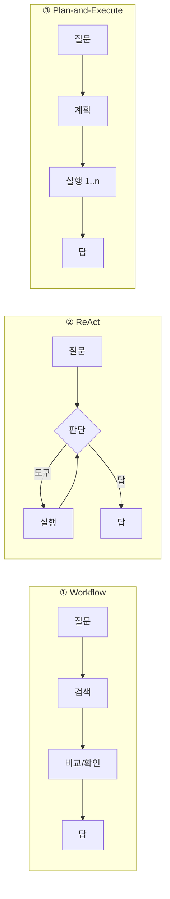

# v0.4 Architecture Study — 토지 상담 Agent 의 구조 비교

측정: 2026-11-07 08:16 · v1.3 벤치마크 문제지 40문제(질문 52개) · 답을 만든 쪽: off (규칙 기반 정책으로 판단) · `python main.py architecture-study` 로 다시 만들 수 있음

## 1. 비교한 구조

모두 **같은 도구**(검색·상세·비교·건축 가능 여부·피드백)와 같은 실행기·안전장치를 쓰고, **흐름 제어만** 다릅니다.

| 구조 | 흐름 | 판단(AI 호출) |
|---|---|---|
| ① Workflow | 질문 → 검색 → (비교/건축 확인) → 정해진 형식의 답 | 없음 (코드가 순서를 정함) |
| ② ReAct | 판단 → 도구 → **결과를 보고 다시 판단** … → 답 | 도구를 쓸 때마다 1번 + 답 1번 |
| ③ Plan-and-Execute | 계획 1번 → 계획대로 실행 → 답 1번 | 항상 2번 (중간에 계획을 고치지 않음) |
| ④ Multi-Agent | 총괄 → 검색 Agent / 분석 Agent → 총괄이 정리 | Agent 마다 따로 (가장 많음) |
| ⑤ ReAct on LangGraph | ②와 같은 판단을 LangGraph 그래프로 (v0.5) | ②와 같음 |

## 2. 결과

| 항목 | ① Workflow (고정 파이프라인) | ② ReAct (기본) | ③ Plan-and-Execute | ④ Multi-Agent (총괄→검색·분석) | ⑤ ReAct on LangGraph (v0.5) |
|---|---|---|---|---|---|
| 문제 통과율 | **75.0%** | **97.5%** | **87.5%** | **97.5%** | **97.5%** |
| 질문 통과율 | 67.3% | 98.1% | 88.5% | 98.1% | 98.1% |
| 정밀도 / 재현율 | 96.6% / 96.6% | 100.0% / 100.0% | 100.0% / 100.0% | 100.0% / 100.0% | 100.0% / 100.0% |
| 질문당 판단 횟수 | 0 | 2.1 | 1.96 | 4.25 | 2.1 |
| 질문당 도구 호출 | 1.15 | 1.12 | 1.1 | 1.12 | 1.12 |
| 응답 시간 p50 (규칙 판단) | 2.8ms | 2.4ms | 2.4ms | 2.9ms | 5.8ms |
| 예상 응답 시간 (AI 판단 1번 1.5초 가정) | 약 0.0초 | 약 3.2초 | 약 2.9초 | 약 6.4초 | 약 3.2초 |
| 결과가 예상과 다를 때 헛도구 호출(오류) | 0 | 0 | 3 | 0 | 0 |
| 흐름 제어 코드 줄 수 | 20 | 54 | 60 | 133 | 47 |

### 분야별 통과율

| 분야 | ① Workflow (고정 파이프라인) | ② ReAct (기본) | ③ Plan-and-Execute | ④ Multi-Agent (총괄→검색·분석) | ⑤ ReAct on LangGraph (v0.5) |
|---|---|---|---|---|---|
| 건축 가능 여부 | 66.7% | 100.0% | 100.0% | 100.0% | 100.0% |
| 검색·정렬 | 85.7% | 100.0% | 100.0% | 100.0% | 100.0% |
| 검색·조건 | 100.0% | 100.0% | 100.0% | 100.0% | 100.0% |
| 말투 바꿔 묻기 | 100.0% | 100.0% | 100.0% | 100.0% | 100.0% |
| 안전·개인정보 | 100.0% | 100.0% | 100.0% | 100.0% | 100.0% |
| 없는 매물 | 100.0% | 100.0% | 100.0% | 100.0% | 100.0% |
| 이어서 묻기 | 33.3% | 100.0% | 100.0% | 100.0% | 100.0% |
| 이어서 묻기·지역 | 71.4% | 100.0% | 100.0% | 100.0% | 100.0% |
| 지역별 매물 수 | 0.0% | 100.0% | 44.4% | 100.0% | 100.0% |
| 추가 문제 | 71.4% | 85.7% | 85.7% | 85.7% | 85.7% |

### 틀린 문제

- ① Workflow (고정 파이프라인): B02, F01, F02, H03, H05, R01, R02, R03, R04, S01
- ② ReAct (기본): H05
- ③ Plan-and-Execute: H05, R01, R02, R03, R04
- ④ Multi-Agent (총괄→검색·분석): H05
- ⑤ ReAct on LangGraph (v0.5): H05

## 3. 해석

- **① Workflow 는 이어서 묻기에 약함** (이어서 묻기 33.3%): '그 중에 넓은 건?', '다른 지역에도 있어?', '정말 없어?' 처럼 앞 대화에 따라 할 일이 달라지는 질문을 코드 순서만으로는 처리 못 함. AI 판단이 없어 가장 싸고 빠르지만, 손님 말의 흐름을 따라가지 못함.
- **② ReAct 는 결과를 보고 다음 행동을 고름**: 검색 결과가 0~1건이면 비교·건축 확인을 건너뜀 → 헛도구 호출 0. 대신 도구를 쓸 때마다 판단(AI 호출)이 늘어남.
- **③ Plan-and-Execute 는 판단이 항상 2번**이라 AI 호출이 많은 질문(검색+비교+확인)에서 ReAct 보다 싸고 빠름. 하지만 계획을 고치지 않아 결과가 예상과 다르면(0건인데 비교) 헛도구 호출·오류가 생기고, '제일 많은 지역 매물 보여줘'처럼 **중간 결과(어느 지역이 많은지)를 보고 다음 일을 정해야 하는 질문**을 처리하지 못함.
- **④ Multi-Agent 는 판단이 약 2배** (총괄 + 전문 Agent). 정확도는 같고 비용·지연이 늘지만, 역할별로 따로 고치고 다른 서버로 나눌 수 있음(v0.8 A2A).
- **⑤ LangGraph 판은 ReAct 와 결과가 같음** (같은 판단 규칙), 프레임워크 때문에 몇 ms 더 걸림 → v0.5 보고서 참고.

## 4. 결정

- **기본 구조: ② ReAct** — 토지 상담은 '그 중에', '다른 지역', '정말 없어?' 같은 이어서 묻기가 많고, 검색 결과에 따라 다음 행동이 달라져야 함. 정확도와 헛도구 호출에서 가장 안정적.
- **확장 구조: ④ Multi-Agent** — 정확도는 같으면서 역할 분리·분산(A2A)이 필요할 때 선택 (화면의 '상담팀'). v1.2 '자동' 방식이 손님 만족도로 둘 중 하나를 고름.
- **비용을 줄여야 할 때: ③ Plan-and-Execute** 를 후보로 둠 (AI 호출이 고정 2번). 단, 0건·1건일 때 계획을 건너뛰는 보완이 필요.
- ① Workflow 는 AI 를 못 쓸 때의 최소 기능 수준과 비교하는 기준선으로만 씀.

※ 이 측정은 AI 대신 규칙 기반 정책으로 판단한 결과입니다. GPT/Claude 를 연결하면 같은 명령으로 실제 AI 판단 횟수·토큰·지연을 잴 수 있습니다.
※ 문제지는 연습용 샘플 매물 기준이라 매물번호는 '(샘플 매물)' 로 가렸습니다.
