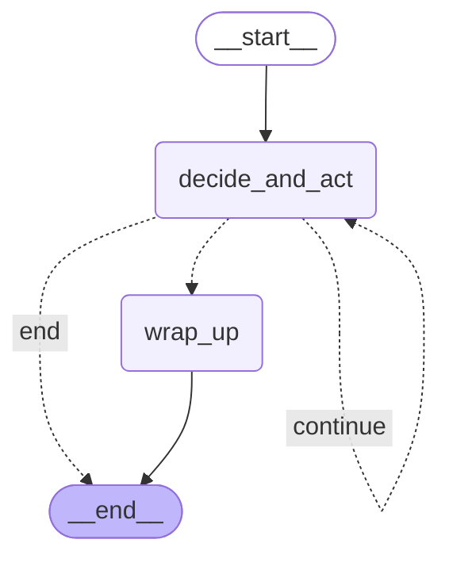

# v0.5 Framework — 직접 만든 Agent vs LangGraph

측정: 2026-11-07 07:44 · LangGraph 1.2.20 · v1.3 벤치마크 문제지 · 규칙 기반 판단

## 1. 무엇을 바꿨나

v0.2 에서 반복문으로 직접 만든 ReAct Agent 를 **LangGraph**(대표적인 에이전트 프레임워크)로 다시 만들었습니다.
공정한 비교를 위해 도구·판단 규칙·안전장치(v1.0)·추적(v1.1)은 똑같이 쓰고 **흐름 제어만** 프레임워크에 맡겼습니다.

| | 직접 구현 (v0.2) | LangGraph (v0.5) |
|---|---|---|
| 흐름 | `for` 반복문: 판단 → 도구 → … | 그래프: `START → 판단·실행 ⟲ → (정리) → END` |
| 대화 상태 저장 | 직접 만든 체크포인트 (SQLite, v0.3) | 프레임워크 checkpointer (대화마다 thread_id) + 직접 만든 체크포인트 |
| 저장된 상태 다시 보기 | 상담 기록 화면 | `get_state_history` 로 단계별 상태 |
| 흐름 그림 | 직접 그림 | 그래프에서 자동 생성 (아래) |
| 흐름 제어 코드 | 54줄 | 47줄 (+ 프레임워크) |
| 추가 의존성 | 없음 | `langgraph`, `langchain-core` 등 |

## 2. 측정

| 항목 | 직접 구현 | LangGraph |
|---|---|---|
| 문제 통과율 | 97.4% | 97.4% |
| 같은 문제를 맞힘 | | ✅ 완전히 같음 |
| 응답 시간 p50 / p95 | 2.4 / 3.3ms | 5.3 / 6.9ms |
| 질문당 판단 / 도구 호출 | 2.12 / 1.14 | 2.12 / 1.14 |

→ 결과는 같고, 프레임워크가 질문당 약 2.9ms 를 더 씀 (상태를 매 단계 직렬화·저장). AI 응답(1~3초)에 비하면 작은 차이.

## 3. LangGraph 가 그린 흐름

## 4. 결정

- **운영(웹·API)은 직접 구현을 유지**: 결과가 같고 더 빠르며, 의존성이 없고, 우리 체크포인트·추적·안전장치와 이미 맞물려 있음.
- **LangGraph 판은 선택 사항으로 둠**: `python main.py agent --framework langgraph`, 벤치마크 설정 `langgraph`. 흐름이 복잡해지면(사람 승인 단계, 분기 많은 상담 등) 그래프 선언·상태 기록·흐름 그림이 유리하므로 그때 옮길 수 있게 같은 실행기(_step)를 공유하도록 만듦.
- 배운 점: 프레임워크는 '반복문·상태 저장·그림'을 대신해 주지만, 도구 설계·판단 규칙·안전장치·평가는 여전히 직접 만들어야 함.
